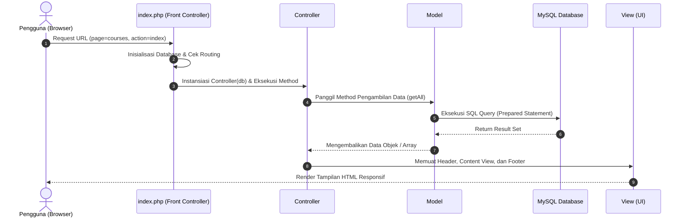
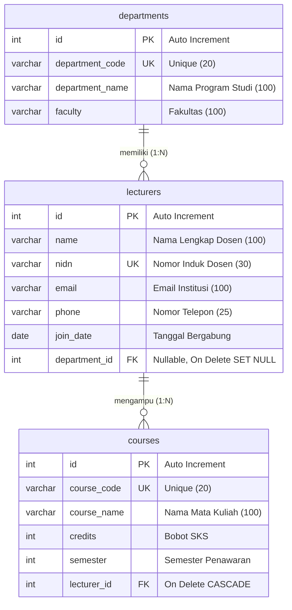

# Academic Management System (PHP Native MVC)

> **Tugas Praktikum 8 (TP8) Desain dan Pemrograman Berorientasi Objek (DPBO)**  
> **Program Studi Ilmu Komputer - Universitas Pendidikan Indonesia**  
> **Tahun Akademik 2024/2025**

---

### 👤 Identitas Mahasiswa
* **Nama**: Muhiban Fadlan Nursaid
* **NIM**: 2400382
* **Kelas**: DPBO C1
* **Janji**:
  > *"Saya Muhiban Fadlan Nursaid dengan NIM 2400382 mengerjakan Tugas Praktikum 8 dalam mata kuliah Desain dan Pemrograman Berorientasi Objek untuk keberkahan-Nya maka saya tidak melakukan kecurangan seperti yang telah dispesifikasikan. Aamiin."*

---

## 📌 Deskripsi Proyek

Aplikasi **Academic Management System** adalah aplikasi web manajemen data akademik yang dibangun menggunakan **PHP Native** berorientasi objek (**OOP**) dengan menerapkan pola perancangan arsitektur **MVC (Model-View-Controller)**. 

Aplikasi ini merupakan transformasi menyeluruh dari arsitektur monolitik/prosedural menjadi arsitektur modular yang rapi, terstruktur, dan mudah dikembangkan (*maintainable & scalable*). Sistem ini mengelola tiga entitas utama yang saling berelasi:
1. **Program Studi (`departments`)**
2. **Dosen (`lecturers`)**
3. **Mata Kuliah (`courses`)**

---

## 🏛️ Arsitektur Sistem & Penerapan Konsep OOP

### 1. Pola Desain MVC (Model-View-Controller)
* **Model (`models/`):** Bertanggung jawab mengelola representasi data, komunikasi langsung dengan basis data MySQL, dan mengeksekusi *query* menggunakan *Prepared Statements* untuk integritas data.
* **View (`views/`):** Bertanggung jawab terhadap antarmuka pengguna (*User Interface*). View hanya menerima data dari controller dan merendernya dalam bentuk HTML/Bootstrap tanpa logika kueri database.
* **Controller (`controllers/`):** Bertindak sebagai penghubung dan pengendali alur logika bisnis. Menerima permintaan (*request*) dari pengguna, memanggil model yang sesuai, dan memuat view yang relevan.
* **Front Controller (`index.php`):** Gerbang tunggal (*Single Entry Point*) untuk seluruh lalu lintas request aplikasi. Mengarahkan permintaan ke Controller dan Method yang tepat berdasarkan parameter URL.

### 2. Prinsip OOP yang Diterapkan
* **Encapsulation:** Seluruh atribut koneksi, nama tabel, dan data internal dienkapsulasi dengan visibilitas `private` dan diakses melalui method publik.
* **Dependency Injection:** Objek koneksi database (`mysqli`) diinjeksikan melalui konstruktor (`__construct($db)`) ke dalam setiap Model dan Controller, mempermudah pengelolaan koneksi dan mengurangi ketergantungan yang kaku (*loose coupling*).
* **Separation of Concerns:** Pemisahan tegas antara logika manipulasi data (*Model*), alur navigasi (*Controller*), dan penyajian tampilan (*View*).

### 3. Diagram Alur Permintaan (Request Lifecycle)



---

## 🗄️ Desain Basis Data & Relasi Tabel

Nama Database: **`tp_mvc25`**

### 1. Diagram Hubungan Entitas (ERD)



### 2. Kamus Data (Data Dictionary)

#### Tabel: `departments`
| Kolom | Tipe Data | Constraint | Keterangan |
| :--- | :--- | :--- | :--- |
| `id` | `INT` | `PRIMARY KEY`, `AUTO_INCREMENT` | Identifikator unik program studi |
| `department_code` | `VARCHAR(20)` | `NOT NULL`, `UNIQUE` | Kode unik prodi (contoh: `IK-01`, `RPL-03`) |
| `department_name` | `VARCHAR(100)` | `NOT NULL` | Nama program studi |
| `faculty` | `VARCHAR(100)` | `NOT NULL` | Nama fakultas penyelenggara |

#### Tabel: `lecturers`
| Kolom | Tipe Data | Constraint | Keterangan |
| :--- | :--- | :--- | :--- |
| `id` | `INT` | `PRIMARY KEY`, `AUTO_INCREMENT` | Identifikator unik dosen |
| `name` | `VARCHAR(100)` | `NOT NULL` | Nama lengkap dosen beserta gelar |
| `nidn` | `VARCHAR(30)` | `NOT NULL`, `UNIQUE` | Nomor Induk Dosen Nasional |
| `email` | `VARCHAR(100)` | `NOT NULL` | Alamat surat elektronik resmi |
| `phone` | `VARCHAR(25)` | `NOT NULL` | Nomor telepon/kontak aktif |
| `join_date` | `DATE` | `NOT NULL` | Tanggal resmi mulai bertugas |
| `department_id` | `INT` | `NULL`, `FOREIGN KEY` | Relasi ke `departments.id` (`ON DELETE SET NULL`, `ON UPDATE CASCADE`) |

#### Tabel: `courses`
| Kolom | Tipe Data | Constraint | Keterangan |
| :--- | :--- | :--- | :--- |
| `id` | `INT` | `PRIMARY KEY`, `AUTO_INCREMENT` | Identifikator unik mata kuliah |
| `course_code` | `VARCHAR(20)` | `NOT NULL`, `UNIQUE` | Kode mata kuliah (contoh: `CS301`) |
| `course_name` | `VARCHAR(100)` | `NOT NULL` | Nama lengkap mata kuliah |
| `credits` | `INT` | `NOT NULL` | Bobot Satuan Kredit Semester (SKS) |
| `semester` | `INT` | `NOT NULL` | Semester paket / penawaran |
| `lecturer_id` | `INT` | `NOT NULL`, `FOREIGN KEY` | Relasi ke `lecturers.id` (`ON DELETE CASCADE`, `ON UPDATE CASCADE`) |

### 3. Aturan Integritas Referensial (*Foreign Key Constraints*)
* **`fk_lecturer_department`:** Jika suatu program studi dihapus dari sistem, data dosen yang terhubung tidak akan terhapus, melainkan kolom `department_id` otomatis diubah menjadi `NULL` (`ON DELETE SET NULL`).
* **`fk_course_lecturer`:** Jika seorang dosen dihapus dari sistem, seluruh mata kuliah yang diampu oleh dosen tersebut akan otomatis terhapus untuk mencegah data mata kuliah tanpa pengampu (*orphan records*) (`ON DELETE CASCADE`).

---

## ✨ Fitur & Kemampuan Aplikasi

* **Manajemen Dosen (`Lecturers`):**
  * Menampilkan daftar dosen beserta relasi nama program studi melalui teknik `LEFT JOIN`.
  * Menambah data dosen baru dengan pilihan program studi melalui *dynamic select dropdown*.
  * Mengubah informasi data dosen.
  * Menghapus data dosen dengan proteksi konfirmasi JavaScript.
* **Manajemen Program Studi (`Departments`):**
  * CRUD lengkap untuk data program studi dan fakultas.
* **Manajemen Mata Kuliah (`Courses`):**
  * Menampilkan daftar mata kuliah beserta nama dosen dan NIDN pengampu menggunakan `INNER JOIN`.
  * Validasi form batas bobot SKS (1–6) dan semester (1–8).
* **Aspek Keamanan & Kualitas Kode:**
  * **Anti SQL Injection:** Menggunakan *Prepared Statements* (`$stmt->prepare()`, `bind_param()`, `execute()`) pada seluruh kueri manipulasi dan pembacaan berparameter.
  * **Anti Cross-Site Scripting (XSS):** Menggunakan fungsi `htmlspecialchars()` pada seluruh keluaran data dinamis di sisi view.
  * **Komentar Kode Lengkap:** Setiap modul kode PHP dan SQL dilengkapi penjelasan singkat mengenai fungsi dan alur logikanya.

---

## 📂 Struktur Direktori Proyek

```text
tp_mvc25/
├── .gitignore                      # Konfigurasi pengabaian file Git (cache, log, OS files)
├── database.sql                    # Skrip pembuatan database, skema tabel, dan data awal
├── index.php                       # Front Controller & Router utama aplikasi
├── README.md                       # Dokumentasi resmi proyek
├── assets/                         # Aset statis antarmuka
│   ├── bootstrap.min.css           # Framework stylesheet Bootstrap
│   ├── bootstrap.min.js            # Library Javascript Bootstrap
│   ├── bootstrap.bundle.min.js     # Bundle Javascript Bootstrap
│   ├── jquery.min.js               # Library jQuery
│   └── popper.min.js               # Library Popper.js untuk komponen popover/dropdown
├── config/                         # Konfigurasi aplikasi & database
│   └── Database.php                # Kelas koneksi MySQLi berbasis OOP
├── controllers/                    # Pengendali logika bisnis aplikasi
│   ├── CourseController.php        # Controller modul mata kuliah
│   ├── DepartmentController.php    # Controller modul program studi
│   └── LecturerController.php      # Controller modul dosen
├── models/                         # Lapisan akses data (SQL Prepared Statements)
│   ├── Course.php                  # Model tabel courses
│   ├── Department.php              # Model tabel departments
│   └── Lecturer.php                # Model tabel lecturers
├── views/                          # Lapisan tampilan antarmuka (User Interface)
│   ├── courses/                    # Tampilan modul mata kuliah
│   │   ├── create.php              # Formulir tambah mata kuliah
│   │   ├── edit.php                # Formulir ubah mata kuliah
│   │   └── index.php               # Tabel daftar mata kuliah
│   ├── departments/                # Tampilan modul program studi
│   │   ├── create.php              # Formulir tambah program studi
│   │   ├── edit.php                # Formulir ubah program studi
│   │   └── index.php               # Tabel daftar program studi
│   ├── layouts/                    # Layout antarmuka bersama
│   │   ├── footer.php              # Template penutup & pemuatan script JS
│   │   └── header.php              # Template navbar navigasi & header HTML
│   └── lecturers/                  # Tampilan modul dosen
│       ├── create.php              # Formulir tambah dosen
│       ├── edit.php                # Formulir ubah dosen
│       └── index.php               # Tabel daftar dosen
└── Dokumentasi/                    # Bukti pengujian & dokumentasi proyek
    └── 2026-11-20 15-20-11.mkv     # Rekaman video demonstrasi fungsionalitas aplikasi
```

---

## 🚦 Matriks Routing & Endpoint URL

Seluruh lalu lintas halaman diatur melalui `index.php` menggunakan parameter `page` dan `action`:

| Modul | Parameter `page` | Parameter `action` | Method HTTP | Controller & Method | Deskripsi |
| :--- | :--- | :--- | :--- | :--- | :--- |
| **Dosen (Default)** | `lecturers` *(atau tanpa parameter)* | `index` | GET | `LecturerController->index()` | Menampilkan daftar seluruh dosen |
| **Dosen** | `lecturers` | `create` | GET / POST | `LecturerController->create()` | Menampilkan form & memproses tambah dosen |
| **Dosen** | `lecturers` | `edit` | GET / POST | `LecturerController->edit()` | Menampilkan form & memproses ubah dosen |
| **Dosen** | `lecturers` | `delete` | GET | `LecturerController->delete()` | Menghapus dosen berdasarkan ID |
| **Program Studi** | `departments` | `index` | GET | `DepartmentController->index()` | Menampilkan daftar seluruh prodi |
| **Program Studi** | `departments` | `create` | GET / POST | `DepartmentController->create()` | Menampilkan form & memproses tambah prodi |
| **Program Studi** | `departments` | `edit` | GET / POST | `DepartmentController->edit()` | Menampilkan form & memproses ubah prodi |
| **Program Studi** | `departments` | `delete` | GET | `DepartmentController->delete()` | Menghapus prodi berdasarkan ID |
| **Mata Kuliah** | `courses` | `index` | GET | `CourseController->index()` | Menampilkan daftar seluruh mata kuliah |
| **Mata Kuliah** | `courses` | `create` | GET / POST | `CourseController->create()` | Menampilkan form & memproses tambah matkul |
| **Mata Kuliah** | `courses` | `edit` | GET / POST | `CourseController->edit()` | Menampilkan form & memproses ubah matkul |
| **Mata Kuliah** | `courses` | `delete` | GET | `CourseController->delete()` | Menghapus mata kuliah berdasarkan ID |

---

## ⚙️ Panduan Instalasi & Menjalankan Aplikasi

### 1. Prasyarat Sistem
* Web Server lokal: **XAMPP** (disarankan), Laragon, atau WAMP Server.
* **PHP $\ge$ 7.4** (Diuji pada PHP 8.2).
* **MySQL / MariaDB**.
* Web Browser modern (Chrome, Edge, Firefox).

### 2. Langkah-Langkah Menjalankan
1. **Tempatkan Proyek ke Direktori Web Server**
   Pastikan folder proyek `tp_mvc25` berada di dalam direktori `htdocs` server web lokal Anda:
   ```text
   C:\xampp\htdocs\tp_mvc25   (atau D:\Software\XAMPP\htdocs\tp_mvc25)
   ```

2. **Jalankan Apache & MySQL**
   Buka aplikasi **XAMPP Control Panel**, lalu klik tombol **Start** pada modul **Apache** dan modul **MySQL**.

3. **Impor Skema Basis Data**
   * Buka browser dan kunjungi `http://localhost/phpmyadmin`.
   * Klik menu tab **Import** pada bagian atas phpMyAdmin.
   * Klik **Choose File**, pilih file `database.sql` yang ada di direktori proyek ini.
   * Klik tombol **Import** di bagian bawah. Database `tp_mvc25`, seluruh tabel relasi, dan data awal (*dummy*) akan otomatis dibuat.

4. **Konfigurasi Koneksi (Jika Diperlukan)**
   Secara *default*, koneksi diatur untuk XAMPP standar tanpa kata sandi pada file `config/Database.php`:
   ```php
   private $host = "localhost";
   private $username = "root";
   private $password = "";
   private $db_name = "tp_mvc25";
   ```
   *Ubah nilai variabel di atas jika pengaturan MySQL lokal Anda menggunakan port atau kata sandi berbeda.*

5. **Akses Aplikasi Melalui Browser**
   Buka browser dan buka tautan berikut:
   ```text
   http://localhost/tp_mvc25/
   ```

---

## 🎥 Dokumentasi & Demonstrasi Pengujian

Dokumentasi rekaman video demonstrasi aplikasi telah disertakan di dalam folder `Dokumentasi/`:
* **File:** `Dokumentasi/2026-11-20 15-20-11.mkv`
* **Cakupan Demonstrasi:**
  1. Pengujian fungsionalitas CRUD pada Modul Dosen (*Lecturers*).
  2. Pengujian fungsionalitas CRUD pada Modul Program Studi (*Departments*).
  3. Pengujian fungsionalitas CRUD pada Modul Mata Kuliah (*Courses*).
  4. Pengujian keutuhan relasi antar tabel (pemilihan dinamis dosen pengampu dan prodi, serta efek *cascade delete*).

---

## 🛠️ Catatan Pemecahan Masalah (Troubleshooting)

1. **Koneksi Database Gagal (*Connection failed*):**
   * Pastikan modul MySQL pada XAMPP Control Panel berstatus hijau (*Running*).
   * Periksa nama database pada phpMyAdmin apakah sudah bernama `tp_mvc25`.
2. **Halaman Tidak Ditemukan (404) atau Tampilan Rusak:**
   * Pastikan nama folder di dalam `htdocs` adalah `tp_mvc25`.
   * Pastikan file aset di dalam folder `assets/` dapat dimuat dengan baik.
